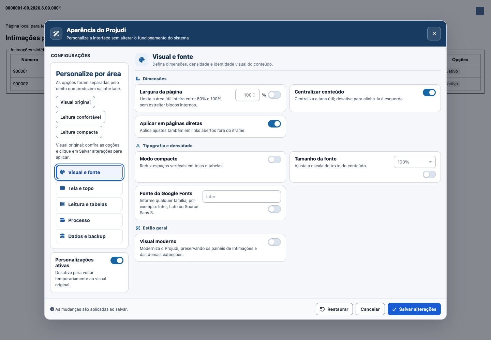
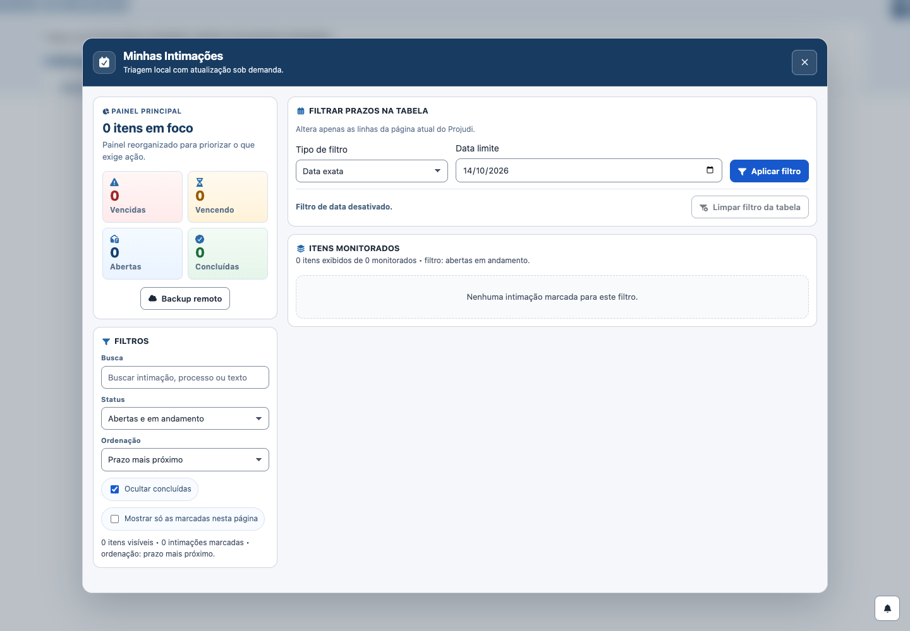

# Revisão de Customizações — 14/10/2026

## Diagnóstico e escopo

O painel instalado no Safari foi inspecionado. Estavam habilitados visual moderno, tabelas e formulários modernos, cabeçalho personalizado, largura de 90%, páginas diretas, altura automática e remoção das barras do iframe. O painel foi fechado com Cancelar; nenhuma preferência foi salva e o wBlock não foi alterado.

O tema usava seletores genéricos para títulos, fieldsets, abas e contêineres sem proteger integralmente as superfícies das extensões. Algumas regras protegiam descendentes, mas não as raízes; outras não tinham proteção. A versão anterior `2131aac` falhou na fixture de isolamento já no primeiro perfil moderno: alterou estilos de uma superfície marcada como pertencente à suíte. Essa reprodução é sintética, não uma captura privada do Projudi.

Também havia dependência indevida entre páginas diretas e ajuste de largura. O payload de Salvar reconstruía somente os campos visíveis, descartando `movimentacoesConfig`. As tentativas de aplicação continuavam depois de o iframe estar pronto e o contexto das tabelas removia/recriava marcadores inalterados.

Somente `customizacoes/projudi-customizacoes.user.js` foi alterado como extensão. Intimações e as outras fontes permanecem intactas; `arquivo/` foi preservado. Versão: **2026.10.14-00:25**.

## Alterações

- O CSS gerado protege tanto as raízes quanto os descendentes das extensões e as tabelas `.pjip-table`. O parser CSS do navegador preserva os seletores compostos e regras aninhadas; a proteção não aumenta sua especificidade.
- Visual moderno mantém o tamanho de texto nativo quando a escala está desativada. Escala de fonte continua sendo uma opção independente.
- Perfis Visual original, Leitura confortável e Leitura compacta preparam tema, tipografia e leitura. Largura, navegação, processos e backup permanecem como escolhidos. Os perfis não salvam automaticamente.
- Categorias têm semântica de abas, uma única parada de Tab e navegação com setas, Home e End. O painel mostra uma categoria por vez.
- Páginas diretas podem ser habilitadas sem ajuste de largura.
- Salvar preserva as configurações de movimentações. Cancelar descarta o rascunho dos perfis.
- CSS protegido tem cache; tentativas do iframe param quando o documento está pronto; os observers ignoram alterações internas da suíte; marcadores de tabelas só mudam quando necessário. Pop-ups nativos continuam protegidos.

Não foi necessário reescrever os recursos de navegação, PDF, backup ou destaque de movimentações.

## Evidências sintéticas

## Validação

| Cobertura | WebKit | Chromium |
| --- | --- | --- |
| Tema moderno, tabelas, formulários e combinação completa; página/iframe, duas ordens e larguras 1440/768/390 | 48 cenários | 48 cenários |
| Perfis, teclado, dimensões do painel, páginas diretas, preservação de preferências e cancelamento | 12 cenários | 12 cenários |
| Interações gerais das cinco extensões | 17 verificações | 17 verificações |
| Layout de abertura das cinco extensões em 1440 px | 5 cenários | 5 cenários |

Passaram **120 cenários específicos**, **34 verificações gerais**, **10 cenários de abertura**, os **26 contratos**, sintaxe, sincronização do núcleo e `git diff --check`. Nos cenários de iframe, o filtro exato reduziu a tabela de duas linhas para uma e Limpar restaurou as duas. As comparações verificaram estilos dos componentes reais de Intimações, proteção de superfícies da suíte, tabelas gerenciadas e pop-ups nativos. As ordens de carregamento foram Customizações → Intimações e Intimações → Customizações. Todas as requisições foram interceptadas e os dados são fictícios.

Relatórios completos e hashes estão em [evidencias](evidencias/). O QA específico é `scripts/qa-customizacoes.mjs`; aceita `PROJUDI_PLAYWRIGHT_MODULE`, `PROJUDI_QA_BROWSER`, `PROJUDI_QA_EXECUTABLE`, `PROJUDI_QA_OUTPUT`, `PROJUDI_QA_SPRITE` e `PROJUDI_QA_SOURCE_ROOT` para comparar um checkout anterior.

## Limite da validação no Safari

A sessão autenticada serviu para inspecionar as opções instaladas. O atalho de Intimações não abriu seu painel nessa sessão; não foi confirmada a causa dessa ausência. A compatibilidade das fontes foi validada em Chromium/WebKit descartáveis. A nova fonte não foi instalada no wBlock e não há confirmação de funcionamento dessa versão na sessão pessoal. As alterações permanecem locais; não houve push.
